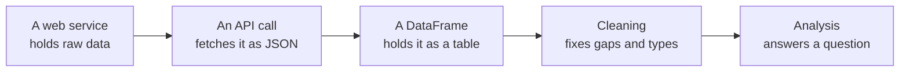

# Pipeline

A model is only as good as the data it is fed. This directory teaches you to build the path that data travels before it reaches a model: get it, load it, clean it, and shape it into something you can analyse.

The goal is not to memorise a library. The goal is to look at a messy source, such as a web service or a CSV with gaps in it, and know the steps that turn it into a clean table ready for analysis.

## From source to insight

Launch data sits behind an API. A request brings it into Python as lists and dictionaries. A DataFrame turns those into rows and columns. Cleaning removes the gaps, and then you can ask the data a question and trust the answer.

## Projects

| Project | What you learn | Status |
|---------|----------------|--------|
| [apis](./apis) | Requests, JSON, pagination, status codes, rate limits, and joining data from several endpoints | Available |
| [pandas](./pandas) | DataFrames, selecting, sorting, cleaning, indexing, merging, and summarising tabular data | Available |

## Where you will meet this again

Every idea here comes back later in the programme. That is why it is worth learning properly now.

| Idea from this directory | Where it comes back |
|--------------------------|---------------------|
| Pagination and ids | Pulling large datasets and joining them across sources |
| Status codes and rate limits | Calling model and embedding APIs without being blocked (Trimester 3) |
| DataFrame from NumPy | Moving between pandas for preparation and NumPy for models |
| Missing values (`fillna`, `dropna`) | Cleaning training data, where gaps break a model |
| Time indexes and resampling | Forecasting from time series (Trimester 3) |
| `describe` and plots | Checking a dataset before you trust a model trained on it |

## How to work through it

1. Start with `apis`. Getting data comes before cleaning it.
2. Read the project README first. It tells you the goal before you start.
3. Look at the raw data before you write any code. Print it, check its shape and its types.
4. Test with your own inputs, not only the ones given.
5. Only then compare with the solution here.
