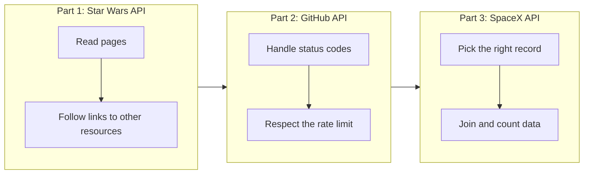
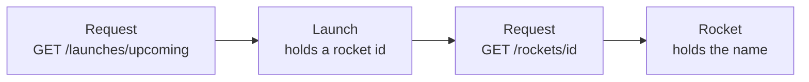

# APIs

Most real data does not sit in a file. It sits behind a web service that you ask for it. In this project you call public APIs from Python, read the JSON they send back, and turn it into answers.

## Goal

By the end of this project you can read an API's documentation, send a request, follow the pages of a long result, and combine data from several endpoints into one answer.

## Learning objectives

After this project you can explain, without looking anything up:

- what an API is, and what a request and a response are
- what an HTTP status code is, and what 200, 403 and 404 mean
- what JSON is, and how to turn it into Python lists and dictionaries
- what pagination is, and how to loop through every page of a result
- what a rate limit is, and how an API tells you that you hit it
- how to use `requests.get` and read `.json()`, `.status_code` and `.headers`
- how to read command line arguments with `sys.argv`

## The path through the project

The project starts with one request and ends with joining data from many requests.



## The one rule to remember

An API response rarely holds the whole answer. It holds a piece of it, plus links or ids that point to the rest. Your job is to follow them.



If you can say which request gives you which piece, you understand the API.

## Key ideas at a glance

| Idea | What it looks like in the code |
|------|--------------------------------|
| Send a request | `requests.get(url)` |
| Read the body | `response.json()` |
| Check the outcome | `response.status_code` |
| Read metadata | `response.headers["X-Ratelimit-Reset"]` |
| Next page | loop while `data.get("next")` is not `None` |
| Follow a link | call `requests.get` on a URL found in the data |
| Follow an id | add the id to the endpoint URL |
| Read a script argument | `sys.argv[1]` |

Status 200 means success, 404 means not found, and 403 means you are blocked, for example by a rate limit.

## Requirements

- Ubuntu 22.04, Python 3.10, `requests`
- Every file starts with `#!/usr/bin/env python3`, is executable, and ends with a new line
- Code passes `pycodestyle`
- Every module and function has a docstring
- Tasks 2 to 4 are scripts, so their code must not run when the file is imported

## Tasks

### Part 1: Star Wars API (SWAPI)

| # | File | What it does |
|---|------|--------------|
| 0 | [`0-passengers.py`](./0-passengers.py) | `availableShips(passengerCount)` returns the names of the starships that can carry at least that many passengers |
| 1 | [`1-sentience.py`](./1-sentience.py) | `sentientPlanets()` returns the names of the home planets of all sentient species |

### Part 2: GitHub API

| # | File | What it does |
|---|------|--------------|
| 2 | [`2-user_location.py`](./2-user_location.py) | Takes a GitHub user URL and prints the user's location, `Not found`, or the minutes until the rate limit resets |

### Part 3: SpaceX API

| # | File | What it does |
|---|------|--------------|
| 3 | [`3-first_launch.py`](./3-first_launch.py) | Prints the next upcoming launch with its rocket and launchpad |
| 4 | [`4-rocket_frequency.py`](./4-rocket_frequency.py) | Prints how many launches each rocket has made, most launches first |

## Running a task

```bash
./2-user_location.py https://api.github.com/users/holbertonschool
./3-first_launch.py
./4-rocket_frequency.py
```

Tasks 0 and 1 are functions. Import them from a main file:

```python
#!/usr/bin/env python3
availableShips = __import__('0-passengers').availableShips
print(availableShips(10))
```

## Resources

- [Requests: quickstart](https://requests.readthedocs.io/en/latest/user/quickstart/)
- [SWAPI documentation](https://swapi.dev/documentation)
- [GitHub REST API documentation](https://docs.github.com/en/rest)
- [SpaceX API v4 (r/SpaceX)](https://github.com/r-spacex/SpaceX-API)
- [MDN: HTTP response status codes](https://developer.mozilla.org/en-US/docs/Web/HTTP/Status)
