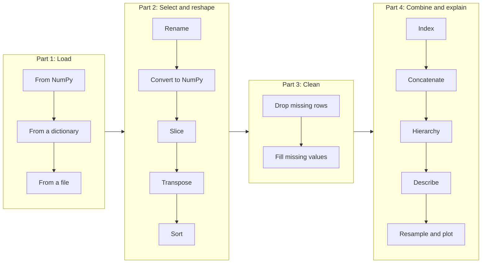
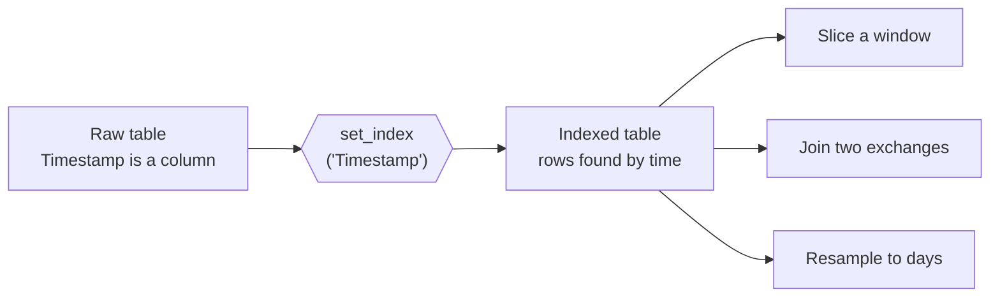

# Pandas

Real data is a table: rows of observations, columns of measurements, and gaps where something went missing. Pandas is the tool that holds that table in Python. In this project you load minute-by-minute bitcoin prices from two exchanges, then slice, clean, combine and summarise them.

## Goal

By the end of this project you can take a raw CSV, say what is wrong with it, fix it, and produce a clean table or a plot that answers a question.

## Learning objectives

After this project you can explain, without looking anything up:

- what a DataFrame is, and how it differs from a NumPy array
- what an index is, and why a time index is useful
- how to select rows and columns with `loc`, slicing and column lists
- how to sort values and the index
- what a missing value (`NaN`) is, and the difference between dropping it and filling it
- what a multi-level index is, and what `concat` does with `keys`
- what `describe` computes
- what resampling does to time series data

## The path through the project

The project follows the life of a dataset: load it, reshape it, clean it, combine it, then explain it.



## The one rule to remember

The index is the label that rows are found by. Choose a good one and everything else gets easier. Set the timestamp as the index and you can slice by time, join two sources on it, and resample it.



If you can say what the index is at every step, you understand what the table holds.

## Key ideas at a glance

| Idea | Pandas |
|------|--------|
| Load a file | `pd.read_csv(file, delimiter=',')` |
| NumPy to DataFrame | `pd.DataFrame(array, columns=[...])` |
| DataFrame to NumPy | `df.to_numpy()` |
| Pick columns | `df[['High', 'Close']]` |
| Pick rows and columns by label | `df.loc[rows, columns]` |
| Every 60th row | `df.loc[::60]` |
| Last rows | `df.tail(10)` |
| Sort by a column | `df.sort_values(by='High', ascending=False)` |
| Swap rows and columns | `df.T` |
| Unix seconds to datetime | `pd.to_datetime(col, unit='s')` |
| Drop rows with a gap | `df.dropna(subset=['Close'])` |
| Fill a gap | `col.fillna(value)` or `col.ffill()` |
| Use a column as index | `df.set_index('Timestamp')` |
| Stack with labels | `pd.concat([a, b], keys=['a', 'b'])` |
| Summary statistics | `df.describe()` |
| One row per day | `df.resample('D').agg({...})` |

## Requirements

- Ubuntu 22.04, Python 3.10, NumPy, pandas, Matplotlib
- Every file starts with `#!/usr/bin/env python3`, is executable, and ends with a new line
- Code passes `pycodestyle`
- Every module and function has a docstring
- The `*-main.py` files are small test scripts, one per task

## Data

The tasks use two minute-level bitcoin price files. They are not stored in this repository because they are large. Download them and place them in this folder:

- `coinbaseUSD_1-min_data_2014-12-01_to_2019-01-09.csv`
- `bitstampUSD_1-min_data_2012-01-01_to_2020-04-22.csv`

Both have the columns `Timestamp`, `Open`, `High`, `Low`, `Close`, `Volume_(BTC)`, `Volume_(Currency)` and `Weighted_Price`. `Timestamp` is in Unix seconds, and a row with no trades has missing values.

## Tasks

### Part 1: Load

| # | File | What it does |
|---|------|--------------|
| 0 | [`0-from_numpy.py`](./0-from_numpy.py) | `from_numpy(array)` turns a NumPy array into a DataFrame with the columns A, B, C, ... |
| 1 | [`1-from_dictionary.py`](./1-from_dictionary.py) | Builds a DataFrame from a dictionary, with the rows labelled A to D |
| 2 | [`2-from_file.py`](./2-from_file.py) | `from_file(filename, delimiter)` loads a delimited file into a DataFrame |

### Part 2: Select and reshape

| # | File | What it does |
|---|------|--------------|
| 3 | [`3-rename.py`](./3-rename.py) | `rename(df)` converts `Timestamp` to datetimes, renames it `Datetime`, and keeps `Datetime` and `Close` |
| 4 | [`4-array.py`](./4-array.py) | `array(df)` returns the last 10 `High` and `Close` values as a NumPy array |
| 5 | [`5-slice.py`](./5-slice.py) | `slice(df)` keeps four columns and every 60th row |
| 6 | [`6-flip_switch.py`](./6-flip_switch.py) | `flip_switch(df)` sorts the data in reverse chronological order, then transposes it |
| 7 | [`7-high.py`](./7-high.py) | `high(df)` sorts the rows by `High`, highest first |

### Part 3: Clean

| # | File | What it does |
|---|------|--------------|
| 8 | [`8-prune.py`](./8-prune.py) | `prune(df)` removes the rows where `Close` is missing |
| 9 | [`9-fill.py`](./9-fill.py) | `fill(df)` drops `Weighted_Price` and fills the missing prices and volumes |

### Part 4: Combine and explain

| # | File | What it does |
|---|------|--------------|
| 10 | [`10-index.py`](./10-index.py) | `index(df)` sets `Timestamp` as the index |
| 11 | [`11-concat.py`](./11-concat.py) | `concat(df1, df2)` stacks the earlier bitstamp rows on top of the coinbase rows, labelled by exchange |
| 12 | [`12-hierarchy.py`](./12-hierarchy.py) | `hierarchy(df1, df2)` shows both exchanges for a time window, with a two-level index sorted by time |
| 13 | [`13-analyze.py`](./13-analyze.py) | `analyze(df)` returns the descriptive statistics of every column except `Timestamp` |
| 14 | [`14-visualize.py`](./14-visualize.py) | Cleans the coinbase data, keeps 2017 onwards, resamples it to daily values, and plots it |

## Running a task

```bash
cd pipeline/pandas
./0-main.py
./9-main.py
./14-visualize.py
```

## Resources

- [10 minutes to pandas](https://pandas.pydata.org/docs/user_guide/10min.html)
- [pandas: working with missing data](https://pandas.pydata.org/docs/user_guide/missing_data.html)
- [pandas: merge, join, concatenate](https://pandas.pydata.org/docs/user_guide/merging.html)
- [pandas: time series and resampling](https://pandas.pydata.org/docs/user_guide/timeseries.html)
